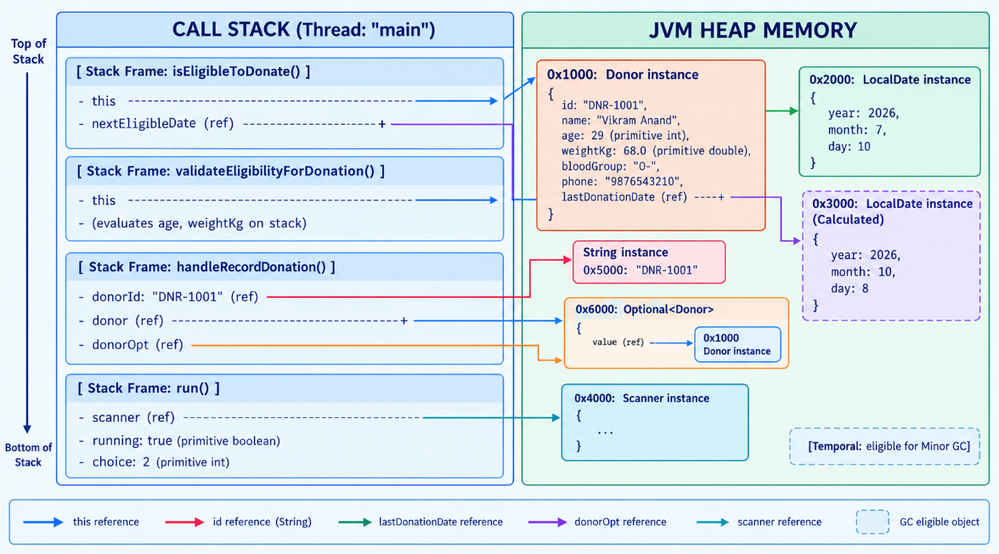

# Day 10: JVM Memory Pitfall Review & Analysis
**Project:** Blood Bank & Donor Management System (JFS-18)
---
## 1. Code Review for JVM Memory Pitfalls

### 1. Unbounded Storage in `InMemoryRepository`
* **Review:** `ConcurrentHashMap` stores all entity instances (`Donor`, `BloodUnit`, `BloodRequest`) in RAM indefinitely.
* **Finding:** For current in-memory simulation and testing, this is safe and fast. However, in a 24/7 hospital production environment, continuously saving thousands of records without pagination or an eviction policy will eventually cause JVM heap exhaustion (`java.lang.OutOfMemoryError: Java heap space`).
* **Production Fix:** Transition from in-memory maps to a persistent database (PostgreSQL/MySQL via Spring Data JPA) or implement an LRU (Least Recently Used) cache with size bounds.

### 2. Defensive Copies vs Heap Pressure
* **Review:** The method `findAll()` returns a fresh copy: `new ArrayList<>(storage.values())`.
* **Finding:** Returning a new copy prevents external code from mutating internal storage directly, avoiding concurrency bugs. However, calling `findAll()` repeatedly inside loops causes unnecessary object allocations on the Heap, increasing GC overhead.
* **Recommendation:** Avoid calling `findAll()` repeatedly inside nested loops. Cache the result locally during batch operations or stream directly.

### 3. Stream & I/O Resource Leaks
* **Review:** `CsvDataLoader` opens external seed files using `getResourceAsStream(...)` and reads them via `BufferedReader`.
* **Finding:** All streams are wrapped inside **`try-with-resources`** blocks.
* **Result:** The underlying operating system file descriptors and native byte buffers are guaranteed to close immediately when execution exits the block, preventing native memory leaks.

### 4. Temporal Object Churn
* **Review:** Dynamic identifier generation concatenates string literals and counters (e.g., `"DNR-" + (++idCounter)` and `"UNT-" + (++unitCounter)`).
* **Finding:** String concatenation creates small, short-lived `String` instances in the young generation (Eden space).
* **Result:** Because these strings are only used during object initialization and have no long-term references, they are cleaned up cheaply by Minor Garbage Collection without degrading performance.

---

## 2. Stack vs. Heap Memory Trace

### Target Method: `Donor.validateEligibilityForDonation()`

